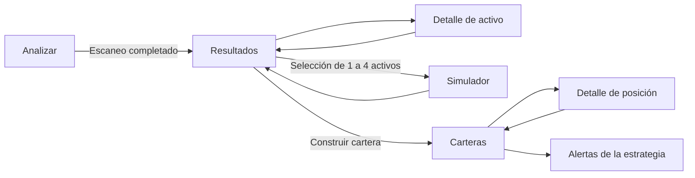

# Frontend Android: flujos y primer alcance

Estado: C1 especificado, **C2 y C3 implementados** (2026-11-01).
C4 sigue pendiente: cierre de recuperación, accesibilidad, teclado e instalación Android.
Este documento concreta el alcance de
[§5.5.3.2 del roadmap](roadmap.md#5532-frontend-separation-and-android-ux-hardening) y el
[plan de separación](frontend-separation-plan.md).

## Entrada y navegación

- Entrada: `android.html`, junto a `index.html`, con rutas por fragmento (`#/scan`).
  Los fragmentos permiten recargar enlaces a pantallas sin añadir rutas de backend.
- Escritorio conserva su entrada y disposición actuales. Ambas superficies ofrecerán un
  enlace explícito para cambiar de interfaz; no se redirigirá por agente de usuario.
- Primera entrega en el navegador, sobre la base PWA existente. La decisión sobre un wrapper
  Android Studio sigue en Fase D; esta especificación no añade un proyecto nativo.
- Cuatro destinos inferiores: **Analizar**, **Resultados**, **Carteras**, **Alertas**.
  **Simulador** se abre desde la selección de resultados. Detalle de activo y posición son
  pantallas secundarias con acción Volver y soporte del historial del navegador.
- Anchos de validación: 360, 390 y 430 px. Botones principales de al menos 44 × 44 px,
  etiquetas visibles y foco reconocible. Las acciones fijas respetarán el área segura y
  tendrán espacio reservado para no cubrir contenido o campos al abrir el teclado.
- Se reutilizarán las preferencias de idioma y diccionarios compartidos. Las nuevas etiquetas
  necesitarán claves ES/EN; cambiar de idioma conservará pantalla, filtros e importes.



La navegación inferior permite acceder directamente a los cuatro destinos, incluso si todavía
no existen resultados o carteras; en ese caso se presenta el estado vacío correspondiente.

## Pantallas y acciones

| Ruta / destino | Contenido y acción principal | Servicios compartidos |
| --- | --- | --- |
| `#/scan` | Mercado, estrategia, explicación breve y **Ejecutar análisis**. Progreso por fase/mercado y contadores; confirmación previa para todos los mercados. | `scan-runner.ts`, `scan-analysis.ts`, `scan-enrichment.ts` |
| `#/results` | Tarjetas con ticker, mercado, nombre, precio, score de la vista y señal. Búsqueda, filtros y orden por la misma vista que escritorio. **Simular (n/4)** y acceso a construir cartera. | `results-filter.ts`, `simulator-selection.ts`, `formatting.ts` |
| `#/asset/:symbol` | Identidad y mercado, scores por horizonte, señal y advertencias del escaneo. **Añadir al simulador** o **Quitar**; vuelve al mismo filtro y posición de lista. | Resultado del escaneo, helpers de selección y formato |
| `#/simulator` | Activos seleccionados, importe mensual por activo, total, preset o plazo personalizado. **Calcular**, resumen de escenarios, gráfico y desglose plegable. | `simulator-service.ts`, `asset-identity.ts`, `request-coordinator.ts`; gráfico SVG de presentación |
| `#/portfolios` | Carteras guardadas y, cuando hay resultados aptos, **Construir cartera**: método, número de activos, capital y perfil de riesgo. Tras construir: resumen, posiciones y **Guardar con nombre**. | `portfolio-builder.ts`, `portfolio-manager.ts`, `performance-tracker.ts` |
| `#/position/:portfolioId/:symbol` | Cantidad, precio de entrada/actual, peso y P&L de una posición. Volver conserva la cartera y sección elegidas. | Modelo de cartera/P&L compartido |
| `#/alerts` | Selector de estrategia, umbrales, canales y notificaciones; **Guardar ajustes**. Historial local de la estrategia en una sección secundaria. | `alert-settings.ts`, `getAlertLogs` del gestor de alertas |

Todas las rutas de la tabla están implementadas. Los parámetros se codifican al
construir URLs y se validan al leerlas. Un activo o una cartera inexistentes muestran una
explicación y un enlace de retorno; no provocan una descarga o cálculo implícitos.

## Comportamiento por flujo

### Analizar y revisar resultados

1. El usuario elige mercado y estrategia y pulsa Ejecutar análisis. Todos los mercados exige
   confirmación; cancelar la confirmación conserva la sesión anterior.
2. Un controlador de aplicación ejecuta el servicio una sola vez y conserva progreso y estado
   aunque el usuario cambie de pantalla. Pulsaciones repetidas no crean otros escaneos.
3. Durante la ejecución, los resultados parciales se identifican como tales. La última revisión
   guardada sigue siendo la referencia hasta completar el nuevo escaneo.
4. Al finalizar se aplican las mismas reglas de enriquecimiento que en escritorio: régimen/ML
   opcional en mercado individual; todos los mercados conserva su comportamiento actual.
   Se persiste el resultado final y se abre Resultados.
5. Un fallo de universo ofrece Reintentar y conserva el último escaneo completo. Un fallo de
   una etapa opcional mantiene los resultados base y su estado degradado.

El ejecutor actual no expone cancelación de un escaneo iniciado. La primera interfaz no
ofrecerá un botón que aparente detenerlo. Recargar o abandonar el documento interrumpe el
trabajo en memoria; al volver se revisará el último resultado completo guardado.

### Filtrar, seleccionar y simular

- Los filtros se editan en un panel desplegable, con resumen activo, contador y Restablecer.
  Cero coincidencias conserva los filtros y ofrece limpiarlos; no se confunde con cero activos
  aprobados por el escaneo ni con ausencia de un escaneo anterior.
- Tocar una tarjeta abre su detalle. Su control de selección es independiente y no abre el
  detalle accidentalmente. El quinto activo queda sin seleccionar y se explica el límite.
- La selección permanece al filtrar, entrar al detalle o cambiar de pantalla. Se identifica
  por símbolo Yahoo, mostrando además ticker y mercado: dos mercados con el mismo ticker
  deben poder seleccionarse y recibir importes diferentes.
- Abrir el simulador muestra sus entradas o la proyección guardada; **no llama a la API**.
  Calcular es explícito. Editar entradas marca la proyección anterior como pendiente de
  actualización; no se presenta como si correspondiera a los nuevos valores.
- Se reutilizan las reglas de importes y horizonte. Calcular está deshabilitado si son
  inválidos o la petición actual está pendiente. Un error conserva entradas y permite reintentar.
- Cambiar selección/entradas invalida la petición anterior. Una respuesta tardía no puede
  sobrescribir el estado, la proyección ni el caché de una petición posterior.

### Construir y recuperar carteras

- Las carteras guardadas son accesibles desde el arranque, sin ejecutar otro escaneo.
  Seleccionar una carga resumen y posiciones en tarjetas; los gráficos son secundarios y
  se muestran bajo demanda, con métricas detalladas desplegables.
- Construir utiliza los resultados del escaneo y la validación compartida. No se construye a
  partir de los filtros visuales de la lista. Se conservan capital, pesos, método, símbolos,
  correcciones de gobernanza y exclusiones del informe de riesgo.
- Guardar pide nombre en un formulario de la propia pantalla. No utiliza `prompt()`.
  Una cartera nueva puede carecer de ratios históricos: se muestra su indisponibilidad sin
  inventar valores. Una posición abre su detalle, conservando el contexto al volver.
- Sin conexión se permite revisar la última información disponible. Construir desde un
  escaneo guardado y guardar una cartera son operaciones locales; Actualizar precios exige
  conexión. La antigüedad de los datos permanece visible.

### Revisar y editar alertas

- La estrategia se elige explícitamente y no depende de haber construido una cartera.
  Al llegar desde una cartera se preselecciona su estrategia.
- Guardar reutiliza valores por defecto, normalización y persistencia compartidos. Se muestra
  confirmación únicamente tras guardar; si falla IndexedDB, se conservan los cambios para reintentar.
- Edición e historial locales funcionan offline. Guardar configuración no envía mensajes.
  Los flujos online que generan alertas mantienen los mismos hooks que escritorio; no se
  introducen reenvíos automáticos ni una cola de entrega offline.

## Arranque, persistencia y estados de red

| Situación | Comportamiento esperado |
| --- | --- |
| Primera visita sin datos | Analizar disponible online; Resultados y Carteras muestran estados vacíos con acción útil. |
| Recarga con revisión guardada | Restaurar datos para revisión, fecha, contexto e inputs sin ejecutar un escaneo ni recalcular la simulación, también estando online. |
| Arranque offline con shell disponible | Mostrar la revisión guardada y fecha; deshabilitar las operaciones de red. Si no hay revisión, explicar qué falta para usarla offline. |
| Pérdida de conexión durante la sesión | Mantener pantalla e inputs; mostrar estado de red sin sustituir silenciosamente datos por un caché anterior. |
| IndexedDB/localStorage no disponibles | Mantener sesión en memoria; informar de que no se ha guardado y permitir reintentar. No anunciar persistencia exitosa. |
| Petición en curso al cambiar de pantalla | Mantener tarea y progreso en el controlador; la pantalla nueva no crea otra petición. |

Se mantienen los stores/keys de IndexedDB compartidos: última revisión de escaneo/simulación,
carteras y ajustes de alertas. Los dos frontends comparten estos datos **si tienen el mismo
origen**; un despliegue con otro origen no implica sincronización. No se implementa sincronización
de pestañas abiertas en este incremento.

La pantalla, filtros, posición de lista y borradores Android son estado de presentación y
necesitan una clave propia versionada. No se sobrescribirá `simulatorSelection` con una
representación incompatible con escritorio. La restauración de revisiones usa
`offline-review-restore.ts`; reabrir una ruta no ejecuta operaciones de dominio por sí solo.

## Integración del primer flujo funcional (C2)

Las siguientes condiciones están cubiertas por C2; la instalación específica se mantiene en Fase D.

| Trabajo | Condición de aceptación |
| --- | --- |
| Entrada/build | Añadir `android.html` y un módulo `src/android/` al build/inyección. La página funciona tanto con Express como con el prefijo `VITE_BASE_PATH` del despliegue estático. |
| Dependencias | La entrada Android importa servicios compartidos; no importa `scanner.ts`, `portfolio-dashboard.ts` ni `pwa-init.ts`, cuyo arranque está ligado al DOM de escritorio. |
| Estado y peticiones | Llevar la coordinación reutilizable del simulador a un servicio compartido y consumirlo desde ambos adaptadores; mantener las protecciones verificadas en Fase B. |
| Identidad | Adaptar selección/restauración compartidas para símbolos canónicos sin romper el almacenamiento de escritorio. Añadir un caso con igual ticker y distinto mercado antes de conectar tarjetas. |
| Elegibilidad de cartera | Exponer en la capa compartida la condición de construcción que todavía comprueba el adaptador de escritorio; evitar otra copia de sus umbrales en Android. |
| Rutas y contexto | Implementar historial, rutas inválidas, retorno al filtro/posición de lista y estado independiente del montaje de cada pantalla. |
| PWA | Reutilizar registro/instalación sin importar el arranque de escritorio. Precargar la nueva entrada y sus assets. El fallback de navegación offline debe devolver el shell correspondiente: actualmente `sw.js` usa `index.html` para todas las navegaciones. |
| Manifiesto | Mantener el `start_url` de escritorio durante el primer incremento. La instalación específica Android y su punto de entrada se validan antes de declarar completada Fase D. |

No hace falta cambiar los endpoints ni añadir autenticación, notificaciones push o una API
alternativa. Se mantiene `API_BASE_URL` para las llamadas y el prefijo de despliegue para assets,
navegación y universos; no se incrustan rutas absolutas a `/` que fallen en GitHub Pages.

## Entregas y verificación

| Incremento | Resultado revisable | Pruebas mínimas |
| --- | --- | --- |
| C1 — especificación (definida) | Este mapa, decisiones de navegación, estados e integración. | Contraste con los contratos actuales; enlaces/documentación coherentes. |
| C2 — primer flujo funcional (implementado) | Entrada Android + Analizar → Resultados → Detalle → Simulador; selección y coordinación compartidas. | A 360/390/430 px: completar escaneo, filtrar, volver del detalle, seleccionar 4 activos, convertir años a meses, calcular, error/reintento y descartar respuestas tardías. |
| C3 — carteras y alertas (implementado) | Construir/guardar/reabrir cartera, detalle de posición, editar alertas por estrategia. | Capital/pesos/símbolos conservados; sin ratios ficticios; persistencia de ajustes y errores de guardado. |
| C4 — cierre Android web (pendiente) | Recuperación de sesión, shell offline, idioma y accesibilidad de los flujos anteriores. | Recarga online/offline sin cálculo implícito, rutas profundas, teclado/área segura, conexión intermitente e IndexedDB bloqueado. |

En cada incremento se mantiene el gate de cobertura compartida y la suite de escritorio de
Fase B. Los E2E Android se identificarán explícitamente y no sustituirán los de escritorio.
El diseño será propio de tarjetas y detalle; reducir el viewport del HTML actual no satisface C2.
Backtesting avanzado, exportaciones y vistas densas de comparación conservan su acceso en
escritorio durante el primer alcance Android. Los cálculos y datos siguen siendo compartidos;
este primer alcance no promete paridad completa de presentación.

## Implementación y validación de C2

- Entrada: `android.html`, módulo `src/android/app.ts`, estilos propios y estado de presentación
  en `gsp.android.session.v1`. El enlace **Vista táctil** del escritorio abre esta entrada.
- Identidad: `asset-identity.ts` distingue símbolos canónicos. La selección Android no escribe
  la clave de selección del escritorio. Los adaptadores de escritorio califican los tickers
  que colisionan, de modo que una revisión Android con dos tickers iguales conserva ambos
  instrumentos/importes al abrirse en escritorio.
- Peticiones: `request-coordinator.ts` se consume desde ambas presentaciones para impedir que
  trabajo invalidado actualice resultados o caché. `simulator-service.ts` ofrece modos de
  identidad explícitos y comprobación estructural de proyecciones.
- Construcción: `canBuildPortfolio` comparte la condición de elegibilidad de escritorio
  (al menos tres resultados con 30 puntos históricos). C3 consume esta condición al construir.
- PWA: registro independiente del arranque DOM de escritorio y fallback separado para cada
  HTML. Los assets precargados también pueden leerse desde el shell cache antes de una segunda
  visita. El manifiesto conserva su entrada de escritorio hasta la validación de instalación.
- Build: Vite e inyección generan ambas entradas, con prefijo de despliegue. Docker copia la
  nueva fuente HTML. La comprobación del build prueba `/global-scanner-pro/`, recarga offline
  inmediata y cambio al shell de escritorio; al terminar restaura el build habitual.

Para abrir la interfaz, ejecuta `npm run build` y `npm start` y pulsa **Vista táctil** en el
puerto que anuncie el servidor, o añade `/android.html` a esa misma URL. En despliegues con
prefijo, conserva también dicho prefijo al abrir la entrada.

```bash
npm run test:e2e:android
npm run test:e2e:build
```

La suite Android cubre el flujo a 360/390/430 px, identidad entre mercados y entre superficies,
error/reintento, respuestas tardías, recarga offline, rutas inválidas y almacenamiento bloqueado.
La validación de esta entrega es Chromium en navegador; no equivale a pruebas en un dispositivo
Android físico ni a validar un wrapper nativo. Los ajustes finos de teclado/área segura y
la validación completa de instalación siguen en C4/D.

Validación de C2 (2026-10-31): **1336 tests unitarios/integración** y **95 E2E Chromium**
(87 de escritorio + 8 Android), más **1 comprobación del build de producción con prefijo**.
Compilación, TypeScript, cobertura y ESLint de los archivos cambiados pasan. Se han revisado
capturas de Resultados y Simulador; los datos de API en E2E son fixtures deterministas.

## Implementación y validación de C3

- Carteras: formulario propio para método, cantidad de activos, capital, perfil de riesgo y
  ajuste de régimen opcional; utiliza el último escaneo completo sin los filtros visuales.
  El nombre se introduce en pantalla. Se guardan símbolos canónicos, capital, método, pesos
  y el informe de construcción (correcciones, exclusiones, perfil y ajuste aplicado).
  La cartera y su primera instantánea se confirman en una sola transacción: un fallo no deja
  una cartera parcial ni la duplica al reintentar.
- Revisión: selector de carteras desde el arranque, tarjetas de posiciones, detalle por ruta
  y retorno a la cartera/posición de lista. `portfolio-review.ts` reutiliza el tracker para
  valorar datos guardados sin consultas implícitas. Los ratios requieren historial suficiente;
  el gráfico y las métricas históricas quedan en una sección plegable.
- Precios: **Actualizar precios** exige conexión, omite cachés de cotización y guarda una
  revisión local con fecha de consulta. Los símbolos sin cotización conservan el valor anterior
  y se indican expresamente. Si cambian posiciones o la instantánea guardada, esa revisión
  deja de aplicarse. No crea snapshots diarios ni fabrica historial.
- Alertas: estrategia independiente o preseleccionada desde la cartera, umbrales normalizados,
  canales, eventos e historial local. Guardar no envía avisos. Los borradores por estrategia
  sobreviven a navegación/recarga, incluso si un umbral se dejó vacío.
- Persistencia: `gsp.android.operations.v1` conserva los borradores de construcción/alertas y
  el contexto de cartera. IndexedDB conserva los mismos stores compartidos con escritorio.
  Los errores de guardado conservan entradas y ofrecen reintento; no anuncian éxito.

Validación de C3 (2026-11-01): **1361 pruebas unitarias/integración en 78 archivos**; cobertura
**94.88 / 82.48 / 95.99 / 96.26%** global y **95.27 / 90.66 / 92.50 / 96.52%** en frontend
compartido (sentencias / ramas / funciones / líneas). Build/TypeScript y ESLint de los archivos
cambiados pasan sin errores. **102 E2E Chromium en 15 specs** pasan (87 de escritorio +
15 Android, incluidos 7 escenarios C3): construcción a 360/390/430 px, persistencia de
capital/pesos/símbolos, detalle, normalización y borradores por estrategia, errores de
guardado con rollback/reintento, revisión offline, precios explícitos y lectura entre superficies.
Además pasa **1 comprobación de producción con prefijo y recarga offline inmediata**,
ampliada a carteras y alertas, en `src/tests/production/android.production.spec.js` (fuera de
las carpetas `build/` ignoradas por Git). La prueba restaura el build normal al terminar.
Los E2E con Express usan módulos sin empaquetar y calientan su grafo bajo control del service
worker antes de la recarga offline; la comprobación de producción verifica la precarga completa.
Las capturas de carteras y alertas se han inspeccionado en Chromium; se mantienen las
limitaciones de emulación y dispositivo físico indicadas para C2.

**Siguiente incremento: C4**, cierre Android web de recuperación de sesión, accesibilidad,
teclado/área segura e instalación, antes de decidir el empaquetado de Fase D.
